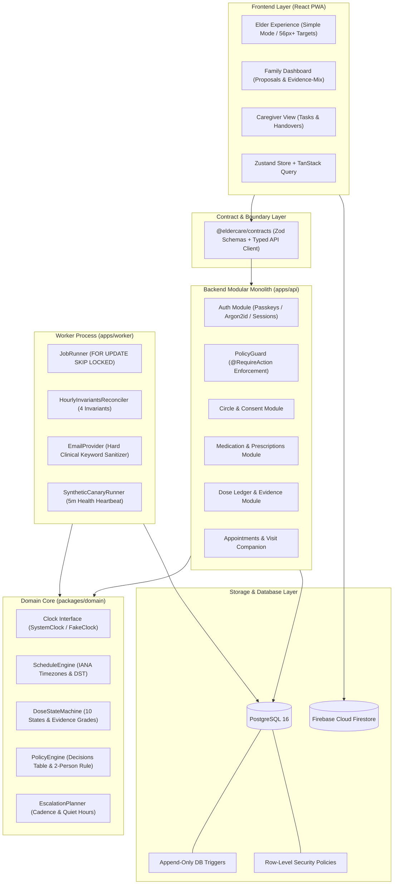

# ELDERCARE 360: System Architecture & Module Boundaries

## 1. Architectural Philosophy & Constraints
ELDERCARE 360 is engineered as a **Modular Monolith** with a distinct background worker process, adhering strictly to safety-critical healthcare software engineering principles:
1. **Zero LLM in Safety-Critical Path**: All scheduling, dose state machine transitions, escalation ladders, and access controls are 100% deterministic code.
2. **Pure Domain Logic Isolation (`packages/domain`)**: Core business rules (Schedules, Dose State Machine, Policy Engine, Care Rules, Escalation) have **zero framework dependencies** and require an injected `Clock` interface for 100% deterministic testing.
3. **Contracts as Single Source of Truth (`packages/contracts`)**: Zod schemas govern all boundaries (REST API inputs/outputs, frontend query types, OpenAPI generation).
4. **Append-Only Immutability in PostgreSQL**: The adherence ledger and audit log prohibit SQL `UPDATE` and `DELETE` via database triggers, reinforced by cryptographic SHA-256 hash chaining.
5. **Two-Tier Authorization**: Primary authorization is enforced by `PolicyEngine.authorize` on every request. PostgreSQL Row-Level Security (RLS) via non-superuser role `eldercare_app` provides defense-in-depth.

---

## 2. Component Diagram

---

## 3. Module Boundaries & Enforcement Rules
1. `packages/domain` **MUST NOT** import NestJS, Express, React, Prisma, or `@eldercare/contracts`.
2. `apps/api` and `apps/worker` **MUST NOT** import from each other. They communicate solely via PostgreSQL transactional job queue.
3. Every controller route in `apps/api` **MUST** declare an `@RequireAction(Action)` decorator; enforced at startup by `verify-route-actions.ts`.
4. Domain logic **MUST NOT** call `Date.now()` or `new Date()`. Time must be acquired through the injected `Clock` instance.
