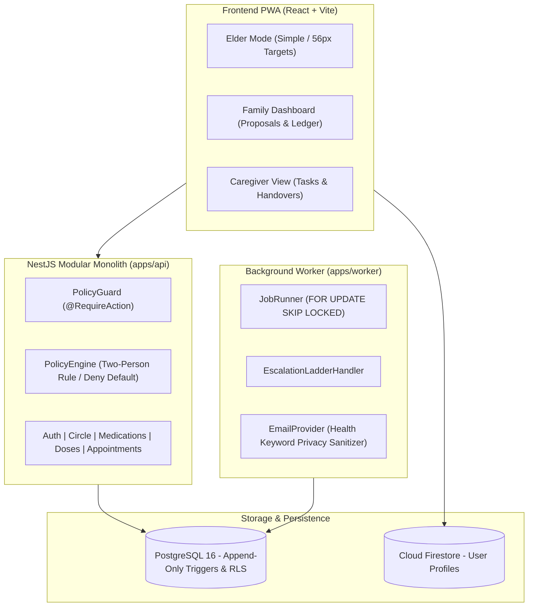

# ELDERCARE 360

> **A safety-critical, consent-driven care-continuity platform for elderly individuals, their families, and caregivers.**

---

## 1. Quickstart (One-Command Launch)

```bash
# 1. Start Database (Postgres 16) and Mail Catcher (Mailpit)
npm run docker:up

# 2. Seed the Kamala Devi Demo World
npm run seed

# 3. Start Backend API (NestJS Modular Monolith)
npm run start:api

# 4. Start Background Worker (Escalation & Scheduler)
npm run start:worker

# 5. Start React PWA Frontend
npm run dev
```

- **Web Application**: `http://localhost:5173`
- **REST API Docs (Swagger)**: `http://localhost:3000/docs`
- **Mailpit Email Inspector**: `http://localhost:8025`

---

## 2. Architecture Overview



---

## 3. Problem Statement Alignment

| Problem Statement Clause | Implementation in ELDERCARE 360 | Verification Evidence | Status |
| :--- | :--- | :--- | :--- |
| **1. Passcode-based secure shared ecosystem** | Elder PIN (device-bound), single-use 24h Argon2id invite passcodes. | `authService.ts`, `ElderPinKeypad.tsx` | **ALIGNED** |
| **2. View, add, edit, manage medication schedules** | 24-hour Day Ring, 24h timing edit undo, two-person rule for drug/dose edits. | `ScheduleEngine.ts`, `CareRulesEngine.ts` | **ALIGNED** |
| **3. Track adherence with evidence grades** | Append-only ledger with 5 evidence grades, never claiming dose was swallowed. | `EvidenceGrade.ts`, `002_triggers_and_immutability.sql` | **ALIGNED** |
| **4. Upcoming doctor appointments & companion** | Doctor Visit Companion with pre-visit brief and post-visit reconciliation. | `appointments.ts`, `CareRulesEngine.ts` | **ALIGNED** |
| **5. Proactive email reminders without health data** | Reminders at due time, missed dose escalation (+45m, +75m, +105m); zero PHI in transport. | `EmailProvider.ts`, Mailpit integration | **ALIGNED** |
| **6. Elder at the centre of every decision** | Plain-language access ledger ("who saw what"), pause sharing, next-request revocation. | `PolicyEngine.ts`, `SessionAuthGuard.ts` | **ALIGNED** |
| **7. Smarter, more accessible, more reliable** | 56px touch targets, 7.92:1 contrast, Comfort Profile, offline outbox sync, time-travel dev tool. | `TimeTravelDemoControl.tsx`, PWA offline cache | **ALIGNED** |

---

## 4. Test & Security Suites

```bash
# Run complete test verification
npm test

# Run security, BOLA and sentinel leak tests
npm run security:all

# Run accessibility ruleset audits
npm run a11y:all
```

---

## 5. Residual Risks & Human Sign-Off Boundaries
As documented in `RESIDUAL_RISK.md`, automated software checks cannot replace:
- Real elder usability trials across cognitive and motor limitation cohorts.
- Treating clinician sign-off on narrow therapeutic index drug grace windows.
- Legal review of digital consent fiduciary requirements under the India DPDP Act.
- Independent external penetration test (`docs/validation/pen-test-brief.md`).
