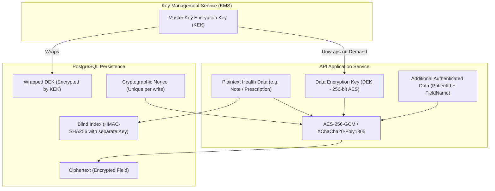

# ELDERCARE 360: Cryptographic Key Management & Data Protection Design

## 1. Cryptographic Architecture Overview
ELDERCARE 360 implements **Envelope Encryption** for sensitive protected health information (PHI) fields, including patient medical notes, custom drug instructions, and sensitive emergency profiles.

---

## 2. Key Hierarchy & Envelope Encryption Specifications

1. **Master Key Encryption Key (KEK)**:
   - Stored in Hardware Security Module (AWS KMS / Cloud KMS / local dev hardware simulator).
   - 256-bit key never leaves the secure HSM boundary.
   - Rotated automatically every 90 days with key versioning.
2. **Data Encryption Keys (DEKs)**:
   - Unique 256-bit AES-GCM data key generated per patient record.
   - Encrypted under the active KEK and stored alongside the ciphertext in PostgreSQL:
     `{ ciphertext: "...", wrapped_key: "...", nonce: "...", kek_version: 1, aad_hash: "..." }`.
3. **Additional Authenticated Data (AAD) Binding**:
   - Every encryption operation binds `PatientId` + `FieldName` as AAD.
   - **Security Guarantee**: An adversary with direct SQL write access cannot copy valid ciphertext from Patient A to Patient B or move a dosage string into a diagnosis column without causing cryptographic tag validation failure.

---

## 3. Blind Indexing for Secure Searchability
- To allow indexing and searching over encrypted fields (such as prescription identifiers or phone hashes) without exposing plaintext in database B-trees:
  $$\text{BlindIndex} = \text{HMAC-SHA256}(K_{\text{search}}, \text{normalize}(\text{field\_value}))$$
- $K_{\text{search}}$ is distinct from both the KEK and DEKs and managed behind the KMS interface.

---

## 4. Crypto-Shredding & Right-to-Erasure
- When an elder invokes their right to data deletion (under DPDP / GDPR regulations):
  - Rather than risking residual fragments in immutable append-only WAL logs or backups:
  - The patient's wrapping keys in KMS are **cryptographically shredded (destroyed)**.
  - All existing ciphertexts across all historical backups and audit records become irreversibly undecryptable computational noise ($2^{-256}$ security margin).

---

## 5. Tamper-Evident Ledger External Anchoring
- Adherence ledger rows form a SHA-256 hash chain:
  $$H_i = \text{SHA-256}(H_{i-1} \parallel \text{ActorId} \parallel \text{Timestamp} \parallel \text{Action} \parallel \text{Outcome})$$
- **Innovation**: The head of the chain ($H_{\text{head}}$) is signed every hour with a dedicated **Ed25519** private key (held outside the application database) and checkpointed to an external append-only log store.
- **Verification Guarantee**: Prevents database administrators or compromised SQL superusers from rewriting history or truncating the tail without immediate detection.
