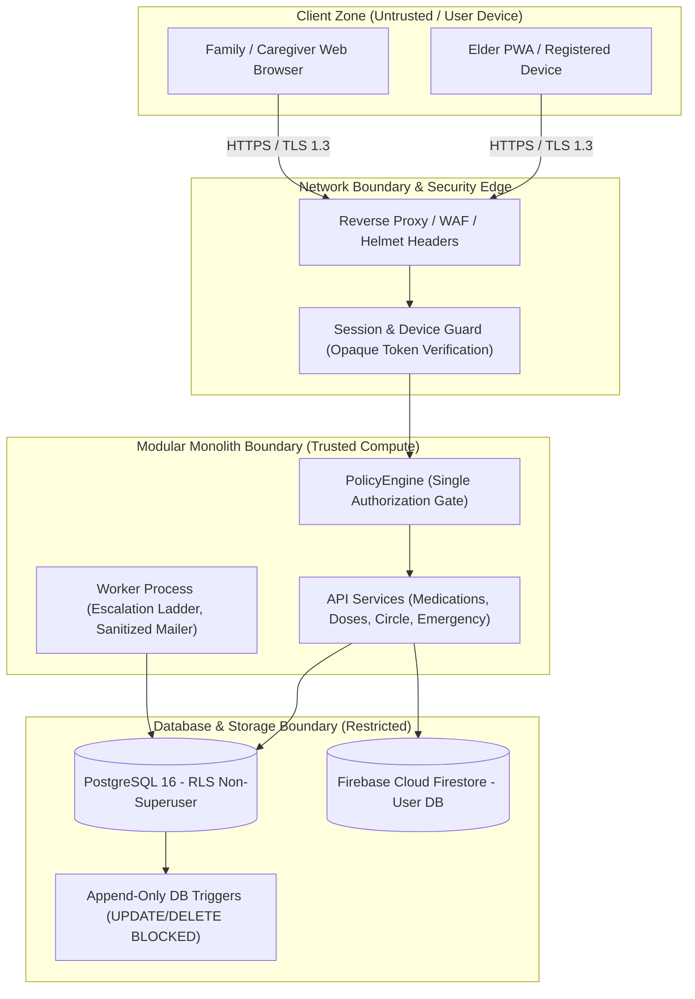

# ELDERCARE 360: Comprehensive Threat Model & Abuse Case Catalogue

## 1. Trust Boundaries & Architecture Diagram

---

## 2. STRIDE Threat Analysis

| Component / Flow | STRIDE Threat | Threat Scenario | Architectural Mitigation | Verification Test |
| :--- | :--- | :--- | :--- | :--- |
| **API Endpoints** | **Spoofing** | Adversary injects `actorId` into request payload to forge actions. | Actor identity is **strictly derived from verified session token** in `SessionAuthGuard`. Request body `actorId` is ignored and rejected. | `generated-authorization-matrix.spec.ts` |
| **Dose Ledger** | **Tampering** | Rogue admin or caregiver alters past dose entry to conceal neglect. | PostgreSQL database trigger strictly aborts any `UPDATE` or `DELETE` on `dose_ledger`. Cryptographic SHA-256 hash chaining detects alterations. | `hash-chain-integrity.spec.ts` |
| **Audit Log** | **Repudiation** | Proposer denies submitting an unverified drug alteration. | Immutable audit log records actor, IP, timestamp, reason, and cryptographic digest. | `AuditLogInterceptor.ts` |
| **Notification Pipeline**| **Information Disclosure** | Email provider or network sniffer captures elder medication or diagnosis. | **Hard privacy barrier**: Email subjects/bodies and metrics are scrubbed of all drug names, dosages, and medical conditions. | `email-privacy-sanitizer.spec.ts` |
| **Escalation Engine** | **Denial of Service** | Malicious insider suppresses alerts by deleting queue jobs. | PostgreSQL transactional queue with `SKIP LOCKED`, hourly invariant reconciler, and synthetic canary probes. | `HourlyInvariantsReconciler.ts` |
| **Circle Grants** | **Elevation of Privilege** | Caregiver self-approves prescription change or circle membership expansion. | Proposer cannot approve their own changes; independent second approver required with verified document reference. | `CareRulesEngine.ts` (Rule R2) |

---

## 3. Top 5 Adversary Attack Trees

### Goal 1: Read Another Elder's Data (BOLA / IDOR)
- **Path A**: Guess UUID in `/api/v1/circle/:elderId/ledger` $\to$ Blocked by `PolicyEngine.authorize` checking active grant $\to$ **FAIL (403)**.
- **Path B**: Direct SQL query bypassing app logic $\to$ Blocked by PostgreSQL Row-Level Security (`fn_has_elder_access`) $\to$ **FAIL (0 rows)**.

### Goal 2: Impersonate an Elder via Stolen Unlocked Phone
- **Path A**: Access app without re-entry PIN $\to$ Critical actions require device-bound PIN or passkey re-auth $\to$ **BLOCKED**.
- **Path B**: Elder triggers Emergency Lock from another device $\to$ Immediate token invalidation across all devices $\to$ **BLOCKED**.

### Goal 3: Silently Suppress Escalation Alerts
- **Path A**: Mark dose confirmed without taking it $\to$ Recorded with `PATIENT_REPORTED` or `CAREGIVER_WITNESSED` grade; un-witnessed remote confirmations flagged by drift detector $\to$ **DETECTED**.
- **Path B**: Drop background worker process $\to$ Synthetic canary detects stall after 5m and alerts admin; reconciler catches up unhandled jobs $\to$ **RECOVERED**.

### Goal 4: Forge Adherence History
- **Path A**: Execute SQL `UPDATE dose_ledger SET status = 'TAKEN'` $\to$ Aborted by `trg_prevent_dose_ledger_mutation` trigger $\to$ **ABORTED**.
- **Path B**: Insert historical row with fake timestamp $\to$ Breaks SHA-256 hash-chain; verifier flags broken link $\to$ **DETECTED**.

### Goal 5: Mass-Exfiltrate Circle Records
- **Path A**: Rapid pagination scrape $\to$ Per-IP / per-session rate limits trigger 429 Tarpit; export endpoint requires step-up MFA and logs plain-language entry to elder's ledger $\to$ **ALERTED**.

---

## 4. Domain-Specific Abuse Cases & Guardrails

1. **Coercive Control & Surveillance Misuse by Family Member**:
   - *Risk*: Family member obsessively monitors elder's minute-by-minute activity.
   - *Guardrail*: Access ledger visibly shows the elder every access event in plain words. Elder has one-touch "Pause Sharing" and "Emergency Lock".
2. **Revoked Ex-Caregiver Access Window**:
   - *Risk*: Fired caregiver accesses home schedule during session cache TTL.
   - *Guardrail*: Zero JWT caching. Every request executes database-backed token lookup; revocation takes effect on the immediate next request.
3. **Grant-Flooding Attack**:
   - *Risk*: Aggressive relative sends repeated grant expansion requests to wear down elder's resistance.
   - *Guardrail*: Maximum 1 pending grant request per 72 hours; 24-hour mandatory cooling-off period on expanded permissions.
